# Inventaire des tuiles 4G inexploitées (#262)

Ce document fait l'état des lieux des packs 4G du projet. Pour chaque planche, il dit ce que la génération procédurale n'utilise pas encore, et à quoi ces tuiles pourraient servir. Il liste aussi les tuiles non 4G que la génération dessine encore, c'est-à-dire ce qu'il faut remplacer avant de supprimer `Outside.png`.

**Méthode.** Le script `tools/art/inventory_4g.py` découpe chaque planche des packs en tuiles de 16 px (les planches en 32 px sont d'abord réduites de moitié). Il cherche ensuite chaque tuile dans les graphismes 4G du jeu : tilesets `Outside 4G`, `Cave 4G`, `Interior 4G` et `Underwater 4G`, autotiles 4G et charsets.
- Une tuile compte comme utilisée si une tuile du jeu a les mêmes couleurs sur au moins 75 % de ses pixels dessinés. Le rose, le magenta, le jaune et le blanc des planches sont ignorés, car ce sont leurs couleurs de transparence ou de case vide. Une tuile posée sur un sol, ou rognée, est donc retrouvée.
- Une tuile **teintée** à la copie n'est pas retrouvée. C'est le cas de la neige, de la cendre et de la lave, tirées de l'herbe et des falaises. Avant de déclarer une planche neuve, il faut donc la regarder.

Pour relancer l'inventaire :

```
python3 tools/art/inventory_4g.py "<dossier des packs>" docs/art/inventaire-4g
```

**Lire les aperçus.** Chaque planche est découpée en carrés de 8×8 tuiles, nommés par une lettre de colonne et un numéro de bande (« C4 »). Chez SirMalo, une colonne de la planche correspond à une lettre.
- Les tuiles déjà dans le jeu sont **grisées**.
- Les carrés cadrés en **rouge** sont inutilisés pour au moins la moitié de leurs tuiles.
- Les étiquettes « LVL » et les flèches des planches SirMalo sont des repères de l'auteur, pas des tuiles.

Les JSON à côté de chaque aperçu donnent le compte par carré.

## Bilan

| Planche | Tuiles dessinées | Dans le jeu | Carrés surtout inutilisés |
|---|---|---|---|
| SirMalo Nature | 3 778 | 1 079 | 59 / 81 |
| SirMalo Buildings | 7 719 | 4 524 | 43 / 171 |
| SirMalo Urban | 2 294 | 293 | 48 / 54 |
| Mew's Gen 4 Interior Tiles | 1 398 | 180 | 26 / 26 |
| Remastered Caves | 1 558 | 53 | 25 / 25 |
| Remastered Johto (JohtoCompactExterior) | 2 323 | 626 | 32 / 38 |
| Remastered Johto ship (Johtoshiptile) | 2 322 | 521 | 34 / 38 |
| Remastered Kanto (KANTO50S_OUT) | 2 160 | 703 | 26 / 35 |
| alchemybats DPP Sinnoh Overworld V2 | 1 864 | 0 | 59 / 59 (inutilisable, voir plus bas) |

Les planches Remastered Johto et Kanto reprennent en partie les rips HGSS de SirMalo. Leurs tuiles « dans le jeu » sont surtout ces doublons.

## SirMalo — Nature

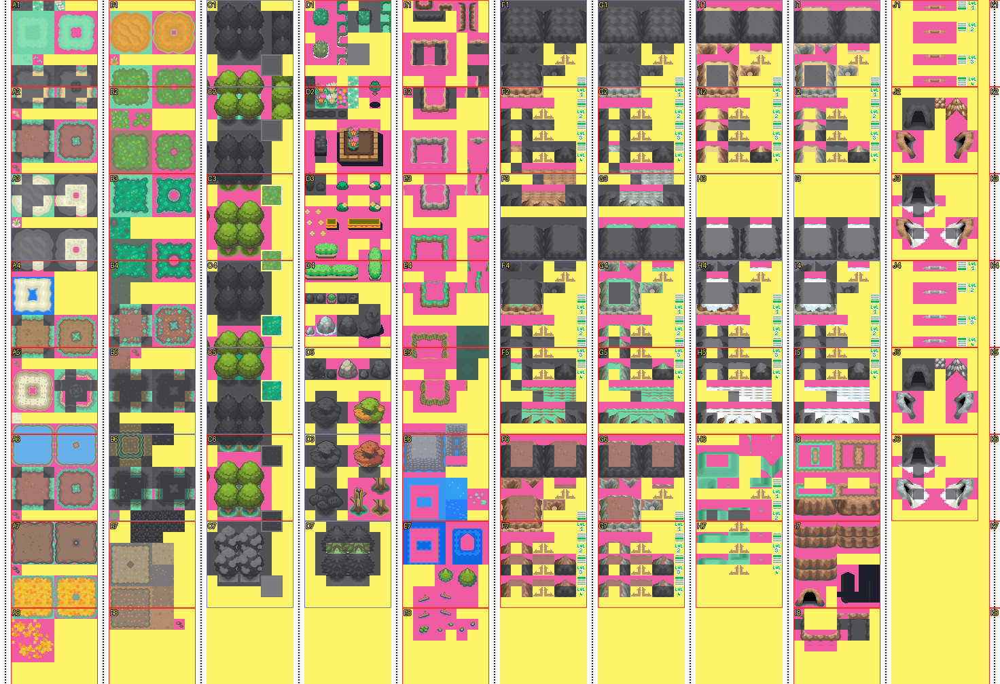

| Carrés | Ce que c'est | Usage proposé |
|---|---|---|
| A1, A3, A5 | Plaques d'herbe pâle et de gravier crème, bordées d'herbe | Sol 4G de l'ambiance **prairie** (remplace T50) et gravier des places |
| A4, A6 | Mare gelée dans la neige, mares bleues bordées | Mares des villes et de la neige : **mare bleue faite (#301)** (A6) |
| A7, A8, B1 | Terre sombre, tapis de feuilles mortes orange, feuilles éparses | Ambiance **automne** (sol, rue, décor) : **fait (#295)** |
| B2 à B4 | Couvre-sols verts denses et herbe sombre turquoise | Variantes de sol des **forêts sombres** et des marais : **fait (#295)** |
| B4, B8 | Plaque d'argile rouge | Sol de **volcan** ou de canyon, sans teinte : **fait (#295)** |
| B7 | Gravier beige | Sol 4G des ambiances **minérale** et **haute montagne** (remplace T218) |
| C1 à C7 | Paires d'arbres vert clair (variante printemps) et carrés d'herbe | Deuxième essence d'arbres de forêt, pour varier les routes : **fait (#297)** |
| D1, D4 | Buissons et **haies** taillées (rangées, coins) | Haies 4G (remplacent î T669 et û T685, et les haies de la prairie T4040 à T4169) : **faites (#262, #317)**, buissons sombres et enneigés, haies basses et hautes |
| D2, D3 | Parterres de tulipes, jardinière en bois, petits buissons fleuris, banc | Décor des villes et parcs (remplace â T523) : **arbrisseau, petits buissons, pot, topiaire et jardinières faits (#317)** ; tulipes et parterre non repris (collés aux hautes herbes) |
| D6 | Arbres d'automne jaune et rouge, souches mortes | Arbres de l'ambiance **automne**, bois mort des marais : **fait (#295)** |
| E1 à E5 | Rebords de petits plateaux (terre, pierre, herbe) et mare sombre | Terrasses basses des villes et des parcs : **fait (#296)** |
| E6, E7 | Mur de pierre, bassins bleus bordés de sable, petits arbres | Bassins des places, jardins |
| E8 | Bois flotté, petites plantes | Décor des **plages** : **fait (#295)** |
| F3, G3 | Grands rebords de falaise vus de face (terre, pierre), plateaux d'herbe | Bord sud des massifs larges : non repris (#318), il faudrait un bord sud propre aux massifs larges |
| F5, G5 | Falaises au bord de l'herbe et de l'eau | Falaises qui plongent dans un lac : non repris (#296), ce sont des pentes de falaise vers l'herbe |
| F6, G6 | Plateaux de terre rouge | Relief du **volcan** ou d'un canyon : **fait (#295)** |
| H1, H2, I1, I2 | Falaises de sable | Relief des **plages** et du désert : **fait (#295)** |
| H3 à H5, I3 à I5 | Falaises enneigées | Falaises du biome neige : **faites (#318)**, à la place des falaises teintées (#204) |
| H6, H7 | Rebords moussus vert d'eau | Rives des **marais** : **fait (#295)** |
| I6 à I8 | Bordures de jardin, grands talus de terre, entrée de grotte sombre | Talus des routes de campagne, entrées de grotte : **talus et grotte sombre faits (#296)** |
| J1, J4 | **Corniches** à sens unique (terre, pierre) | Corniches 4G (rebords où l'on saute) : **fait (#296)** |
| J2, J3, J5, J6 | Entrées de grotte avec éboulis (terre, neige, pierre) | Entrées de grotte variées par biome : **J2, J5, J6 faits (#296)**, entrées latérales brune, grise et enneigée ; J3 non repris |

## SirMalo — Buildings

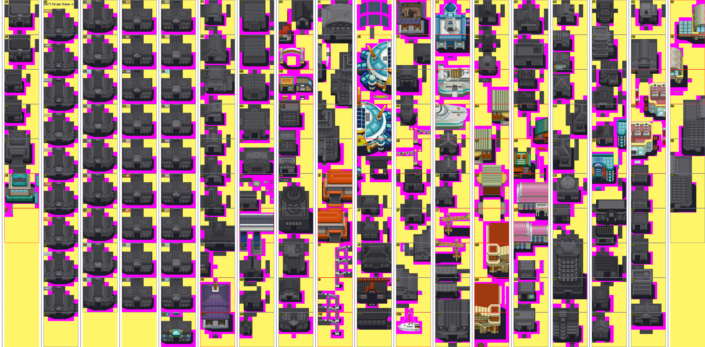

Les maisons, Centres, Boutiques et arènes par type sont déjà dans le jeu (#199). Restent surtout des **bâtiments uniques** :

| Carrés | Ce que c'est | Usage proposé |
|---|---|---|
| A6 | Pavillon vitré vert d'eau | Club des nageurs, aquarium (guilde des Nageurs) |
| F9, F10 | **Pagode** violette (tour à étages) | Tour du Pacte, lieu de lore lié à Arceus : **fait (#299)** |
| G6, G7 | Nénuphars ; quai couvert à toit gris | Gare maritime, marais |
| H1 à H3 | Coin en brique rouge, **arche** décorée, étals de marché à auvent orange | Entrée de ville, marché : **étal fait (#299)** |
| I6, I7 | Grand bâtiment à toit orange | Théâtre, salle des fêtes de la Famille |
| I8 à I10 | Rails métalliques courbes | Voie ferrée, montagnes russes de la foire |
| J1 à J5 | Grand **dôme** futuriste bleu et or | Stade, siège de la Famille dans une métropole : **fait (#299)** |
| J9, K1 | Bâtiment rouge à l'entrée japonaise, maison à toit bleu | Dojo, manoir d'un Ancien |
| K5 | Guirlandes de fanions sur poteaux | Foire des Forains, fête de ville : **fait (#299)** |
| K10, L3, L4 | **Voilier**, **paquebot** | Ports (remplacent le bateau b T1096) : paquebot non repris (#299), trop grand pour la mer d'un port |
| L1, L2 | **Phare** | Ports et caps : **fait (#299)** |
| L7, L8 | Portique en bois | Entrée de quai ou de parc |
| M3 à M6 | Étals à auvent rayé vert | Marchés, marchand ambulant (#176) |
| M7 à M10 | Bâtiment octogonal à toit rouge | Salle de jeux, casino de la Famille : **fait (#299)** |
| N4 à N8 | Bâtiment à toit vert en bois, bâtiment à toit rose vitré | Boutiques spéciales, QG de guilde |
| P5, P6 | Tour de verre bleue | Gratte-ciel de métropole : **fait (#299)**, sans porte |
| Q3 à Q5 | Bâtiment à toit rouge et blanc | Gare, grand magasin : **fait (#299)** |
| R1 à R3 | Serre en verre arrondie | Jardin botanique, labo de recherche : **fait (#299)** |

## SirMalo — Urban

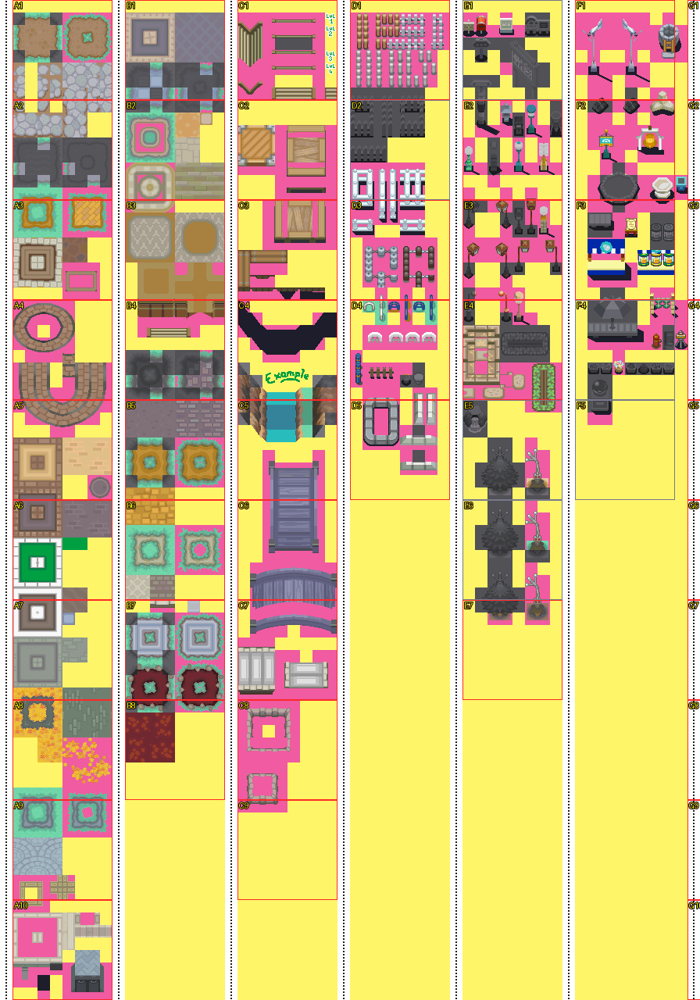

| Carrés | Ce que c'est | Usage proposé |
|---|---|---|
| A1 à A3, A5 à A10, B1 à B8 | **Revêtements** : pavés ronds, briques, dalles, mosaïques, place circulaire en brique (A4), feuilles sur pavés, tapis rouge | Rues et places variées par style de ville (italien, américain, français), places d'arène : **A1, A3 faits (#298)** ; **B2, B8, B9 faits (#316)** (ardoise bleue, pavé sombre, ocre) |
| A4 | Place circulaire en brique | Rond-point, place de la fontaine : **placette ronde faite (#298)** |
| C1 à C3 | **Pont en bois**, caisses | Pontons et quais 4G (remplacent \| et ( _ ), T1205 à T1223) |
| C4, C5, C6, C7 | Pont au-dessus d'une rivière avec marches, **pont en pierre** en arche, bancs de pierre | Ponts des rivières de ville : **pont de pierre C5, C6 fait (#298)** ; C6, C7 (ponts vus de côté) non repris |
| C8 | Murets de pierre | Enclos de place, jardins |
| D1 à D5 | **Clôtures** : poteaux en bois, palissade blanche, garde-corps métalliques, bornes | Clôtures 4G des villes (les enclos en bois sont déjà dans le jeu) : **en partie fait (#298)** |
| E1 à E5 | Mobilier urbain : boîte aux lettres, poubelles, réverbères, panneaux, distributeurs | Décor de rue (les réverbères et bancs sont en partie déjà là, #200) : **en partie fait (#298)** |
| F1 à F4 | Éoliennes, rochers, panneaux d'affichage, étal de fruits, lanternes, bouche d'incendie, statues | Décor de ferme (éoliennes), de marché et de place : **faits (#320)** sauf la vasque et le range-vélos (débordent de la colonne) |

## Mew's Gen 4 Interior Tiles

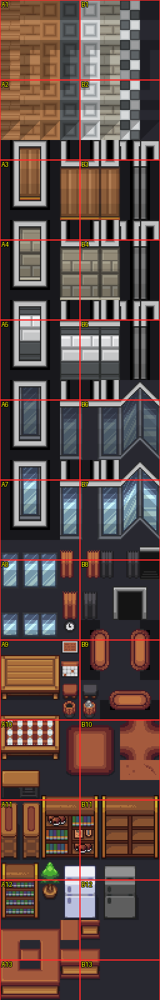

Seuls les sols sont utilisés (#194). Le reste est le **mobilier 4G** des intérieurs (#46) : murs en bois, pierre et plâtre (A1 à B7), fenêtres (A6 à B8), rideaux et horloge (B8), tables et nappes (A9, A10), tapis (B10), bibliothèques et commodes (A11, B11), plante verte, réfrigérateurs (A12, B12), bureaux (A13).

## Remastered Kanto Johto Map Pack

Les intérieurs de grotte (`Caves.png`) et les extérieurs (`JohtoCompactExterior`, `Johtoshiptile`, `KANTO50S_OUT`) sont rangés par huit colonnes.

### Caves

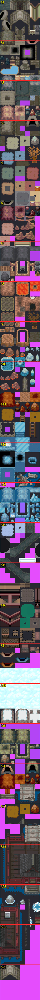

| Carrés | Ce que c'est | Usage proposé |
|---|---|---|
| A1 à A5 | Murs de grotte gris et beiges, formations rocheuses, lac souterrain, arbre de corail mort | Variantes de grotte par biome (Cave 4G n'a qu'une roche) |
| A6 à A9 | Roches violettes et rouges, **bassins de lave** | Grottes du **volcan** : **sol rouge fait (#300)** |
| A10 à A13, A18 | Cristaux et sol de **glace**, plafonds enneigés | Grottes de la **neige** : **fait (#300)** |
| A14, A15 | Passerelles et rails de grotte | Galeries de mine : non repris (#300), les grottes générées ne posent pas de décor |
| A16, A17 | Planchers et caisses en bois | Mine, repaire des Contrebandiers : **plaques de gravier et sol pavé faits (#300)** pour le style mine ; planchers et caisses non repris |
| A19 à A21 | Grottes moussues et brunes | Grottes des forêts et des marais : **fait (#300)** |
| A22 à A24 | Intérieur de temple rouge, **tourbillon** | Sanctuaire d'Arceus, tourbillons en mer : non repris (#300), le temple est un bâtiment entier et le tourbillon est coupé par le bord de la planche |

### Johto (JohtoCompactExterior et Johtoshiptile)

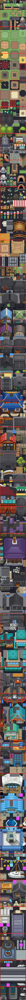
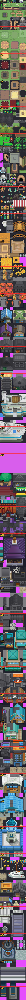

| Carrés | Ce que c'est | Usage proposé |
|---|---|---|
| A2 à A4 | Plaques de sol : herbe, terre, **terre rouge labourée** | Champ labouré 4G (remplace ô T617), potagers |
| A6 (ship) | **Palmiers**, haies taillées | Arbre tropical 4G (remplace ç T563 et ï T606) |
| A7, A8 | Fleurs, rochers, plantes, auvent rayé | Décor de ville, marché |
| A9 | Lanternes de pierre, **pont en bois** arqué | Jardins, rivières |
| A10, A11 | Planchers, caisses, palissades, poteaux | Quais, enclos |
| A10, A11 (ship) | Tapis de feuilles mortes, arbres d'automne | Ambiance **automne** |
| A15, A16 | Temple japonais à toit bleu | Sanctuaire, lieu de lore |
| A16, A17 (ship) | **Paquebot** (S.S. Aqua) | Port de la gare maritime |
| A18, A19 | Bonsaï, grand arbre rond | Parcs, arbre remarquable de place : **fait (#297)** |
| A20 à A22 | Pagode violette, bâtiment rouge | Tour du Pacte |
| A25 à A32 | Bâtiments verts, turquoise, dôme bleu, tour orange vitrée | Bâtiments de métropole |
| A33 | **Phare**, guirlandes, **voilier** | Ports |
| A36 | **Fontaine** et statue sur place pavée | Fontaine 4G (remplace f T1125) |
| A37, A38 | Jetée et navires | Ports |

### Kanto (KANTO50S_OUT)

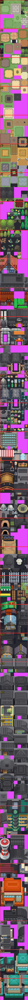

| Carrés | Ce que c'est | Usage proposé |
|---|---|---|
| A1 à A6 | Plaques d'herbe, de terre, de sable, de planches | Sols de villes et de plages : **rues de terre, de sable, de dalles ocre et de pavés violets faites (#316)** |
| A7 | Mares | Mares des villes |
| A8, A9 | Arbres ronds, arbres fruitiers, plantes, fleurs | Vergers des Éleveurs, parcs : **fait (#297)** |
| A10, A11, A22, A23 | Maisons à toit rouge, brun, vert, violet ; haies | Styles de maisons en plus (#199) : **verrière, verte au toit orange et toit violet faites (#299)** (A22, A23) |
| A14, A15 | Lampadaires, parterres de fleurs | Décor de rue |
| A16, A29 | Tours de verre | Gratte-ciel de métropole |
| A17, A21 | Auvent de marché, **pont en bois**, clôtures blanches | Marchés, rivières |
| A26, A32 | Bâtiment jaune, bâtiment à toit orange | Grands magasins |
| A30 | **Phare** rouge et blanc | Ports |
| A34, A35 | Bâtiments turquoise | Métropole |

## Petites planches et autotiles

Compte des tuiles retrouvées dans le jeu, sur le nombre de tuiles dessinées (`petites-planches.json`).

| Planche | Dans le jeu | Usage proposé du reste |
|---|---|---|
| DPPt `Base`, `Sand` | 96/96, 36/96 | Sable : rebords des plages |
| DPPt `Concrete Path`, `Dirt Path`, `Grassy Path`, `Path` | 16/96, 16/96, 16/96, 12/96 | Chemins à bords arrondis (seuls les centres sont pris) : rues de terre et de béton des styles de ville : **béton, terre et sable faits (#316)** |
| DPPt `Canalave`, `Hearthome`, `Jubilife`, `Oreburgh City Set`, `Eterna City Road` | 16/120, 16/120, 16/100, 4/112, 8/60 | Sols de ville propres à chaque style : **Hearthome, Jubilife, Oreburgh et Eterna faits (#316)** ; Canalave (sans bords) non repris |
| DPPt `Eterna Forest Set` | 40/192 | Sol de **forêt sombre** : **fait (#295)** |
| DPPt `Snow Patches` | 13/64 | Plaques de neige sur l'herbe (lisière du biome neige) : **fait (#301)**, congères posées en haute montagne |
| DPPt `Berry Soil` | 4/36 | **Terre à baies** (champ labouré, potager) : **faite (#317)** |
| DPPt `Ledges` | 8/58 | Corniches DPPt |
| DPPt `Flower` (quatre autotiles), `Flowers (Static)`, `Grass`, `Tall Grass` | 0 | Fleurs 4G (remplacent les fleurs * T4046 de la prairie) : **fleurs animées et fixes faites (#317)**, dans le massif `*` |
| HGSS `Flowers 02`, `Flowers 04` | 0/25, 0/25 | Fleurs d'autres couleurs : **`Flowers 02` fait (#301)**, en autotile supplémentaire |
| HGSS `Beach` | 0/288 | Rive de sable animée (remplace les rives T833 et T841) : **fait (#301)**, autotile `HGSS Shore` (A7) de la plage |
| HGSS `Ledge` | 224/320 | Corniches (en partie déjà prises) |
| HGSS `Waves`, `Sea`, `Beach Corner` | 218/288, 224/352, 192/352 | Déjà utilisés, sauf quelques images |
| Remastered `Lake`, `Land`, `Land2`, `STILL`, `Cavewater`, `A_beach`, `TFJ_Waterfall` | 0 | Eau des grottes (Cavewater), cascades 4G animées (TFJ_Waterfall, à la place des cascades d'Essentials : non repris (#301), bleu nuit quand l'eau du jeu est bleu clair ; les cascades d'Essentials sont animées à la place), lacs |

## Autres packs

- **Ultimate Gen 4 Overworlds Pack** : 78 des 334 planches de « All Official Overworlds » sont copiées telles quelles. Les dossiers « DP Beta Overworlds » (28), « Zaffre's Overworlds » (75) et « Animations & Others » (47) ne sont pas utilisés. On pourrait en tirer des habitants et membres de guilde plus variés, ainsi que les animations d'herbe et de surf au style DS.
- **Easy Weather Effects** : c'est un plugin de scripts (lucioles, pétales de cerisier, poussière de diamant, pluie d'étoiles…), sans planche de tuiles. Il n'est pas utilisé, car la météo 4G est dessinée par `tools/art/weather_4g.py`. Les lucioles et les pétales iraient bien aux ambiances forêt sombre et printemps.
- **alchemybats DPP Sinnoh Overworld V2** : ce n'est qu'un **aperçu au quart de la taille** (64 px de large). Toute la région de Sinnoh y est (sols, arbres, villes, neige, désert, automne), mais il ne peut pas servir tel quel. Il faudrait la planche en taille réelle.

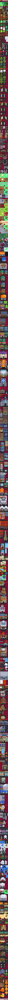

## Tuiles non 4G encore dessinées par la génération

`Outside 4G.png` est construit à partir d'`Outside.png` (`tools/art/outside_4g.py`). Sur les 4 896 tuiles d'`Outside.png`, 4 691 sont restées identiques. Parmi elles, **142 sont encore utilisées** par MapProc : légendes, terrains, objets de `route.txt` et `ville.txt`, sur toutes les ambiances. Ce sont des tuiles de 3G ou d'Essentials. Il faut les remplacer avant de pouvoir retirer `Outside.png`.

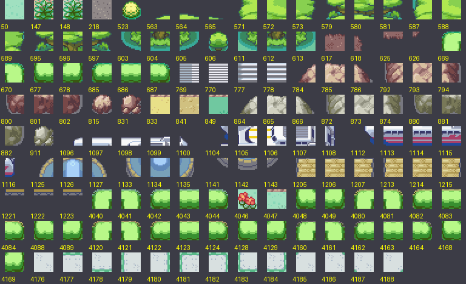

| Élément (symbole) | Tuiles | Remplacement 4G proposé |
|---|---|---|
| Sol de la prairie | T50 | Nature A1 |
| Rue de la prairie | T4176 à T4188 | Nature A3 ou Urban A1 |
| Fleurs de la prairie (*) | T4046 | DPPt `Flowers (Static)` ou HGSS `Flowers 02` |
| Rive de la prairie, du sable, de la terre battue, de l'herbe (Rive, ! ' ?) | T4047, T833, T841, T849 | HGSS `Beach`, rebords Nature E1 à E5 |
| Sol et rue des ambiances minérale et haute montagne | T218 | Nature B7 |
| Herbes de montagne (n) | T147, T148 | Nature D1 |
| Escaliers de montagne (e f ɛ g h E F G H) | T769, T770, T777, T778 | Aucun escalier de roche chez SirMalo : marches des grottes Remastered (Caves A1 à A3) à essayer, sinon à dessiner |
| Caillou (o), rochers (u ö), mur de rochers (R) | T815, T911, T784 à T882 | Nature D4, D5 (rochers déjà importés en partie) |
| Buisson jaune (â), buisson tropical (ï) | T523, T606 | Nature D3, Johtoshiptile A6 |
| Arbre tropical (ç) | T563 à T613 | Palmiers de Johtoshiptile A6 |
| Champ labouré (ô) | T617 à T626 | DPPt `Berry Soil`, Johto A3 |
| Haies (î û, et leurs copies par sol) | T669 à T687, T4040 à T4169 | Haies de Nature D4 |
| Ponton en bois et son rebord (\| ( _ )) | T1205 à T1223 | Urban C1 à C3 |
| Fontaine ronde (f) | T1125 à T1143 | Johto A36 ou fontaine de SirMalo déjà importée (#200) |
| Bateau amarré (b) | T1096 à T1116 | Voilier de Buildings K10 |

**Fait depuis** (`tools/art/replace_non4g.py`) : ces tuiles sont remplacées ou ne sont plus utilisées.

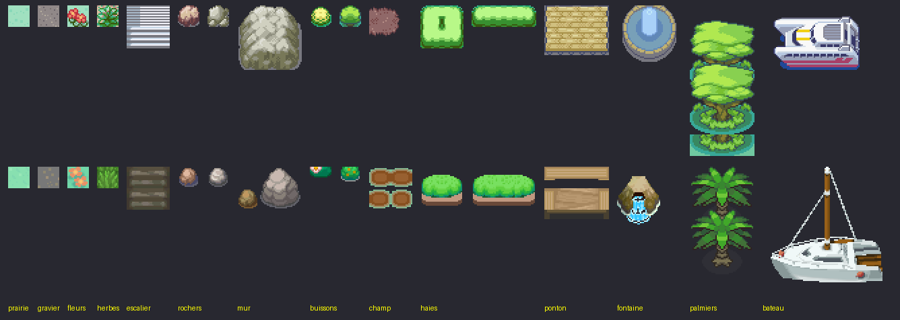

Les 4 549 autres tuiles d'`Outside.png` restées dans `Outside 4G.png` ne sont plus utilisées par la génération. Cela comprend les objets d'Emerald Outdoor et de KingTapir (#110), retirés des lieux depuis #200.

## Cartes et tilesets non 4G

- La génération n'utilise que les tilesets 24 (Outside 4G), 25 (Cave 4G), 26 (Interior 4G) et 27 (Underwater 4G), plus les intérieurs d'Essentials, qui sont gardés.
- Les tilesets extérieurs non 4G (1 Outside, 2 Outside waterfall, 6 Caves, 7 Dungeon cave, 9 Boat, 21 Underground Path, 22 Underwater, 23 Dungeon forest) ne servent plus qu'aux **cartes de la démo** d'Essentials et aux **exemples de MapGen** (`MapGen/*.txt`, tileset 1).
- Deux de ces cartes servaient de modèles d'événements : Route 3 (31), pour l'arbre et le rocher des recoins, et Ice Cave (34), pour le bloc de Force (`NOOK_EVENTS`).
- Fait depuis : les cartes démo extérieures et ces tilesets sont supprimés ; la carte 31 « Modèles d'événements » garde les trois obstacles.
